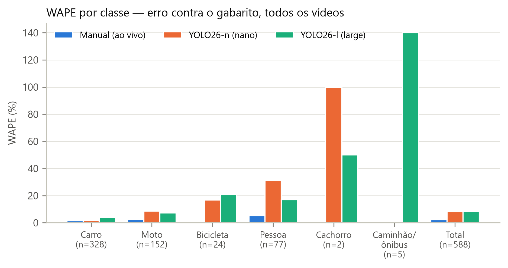
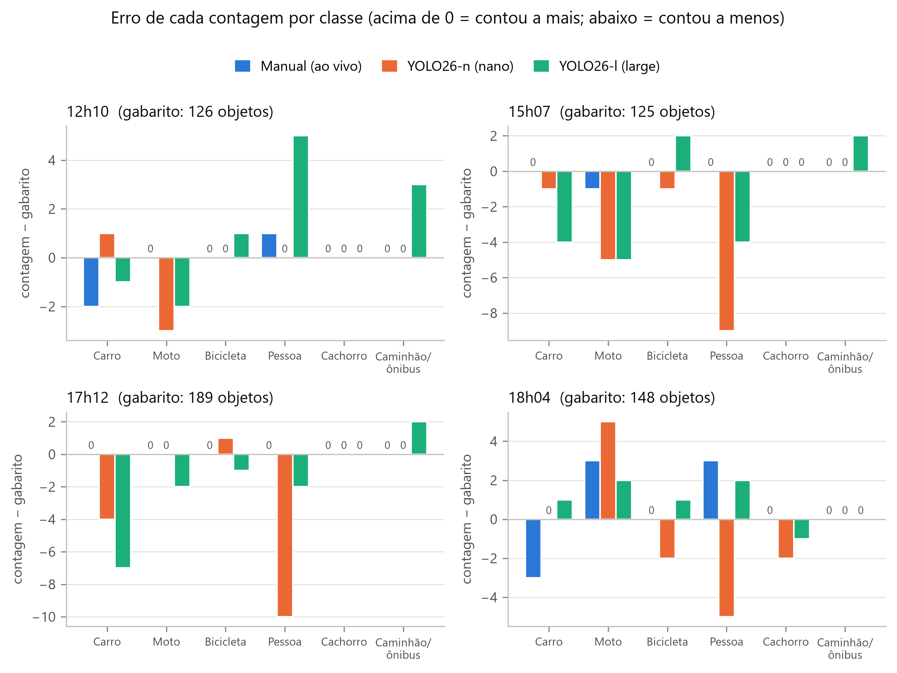
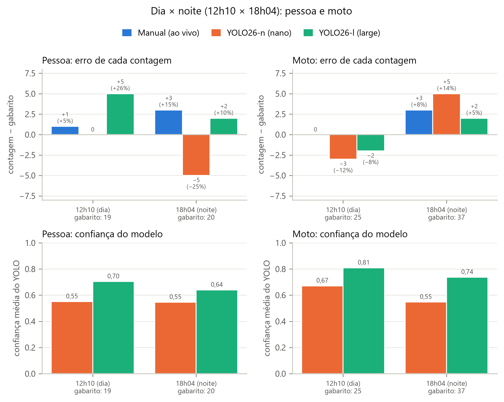

# Contagem classificada de tráfego: YOLO × contagem manual

Trabalho da disciplina de **Visão Computacional** (pós-graduação).

Aluno: Josué de Vasconcelos Silveira Moreira

Uma câmera fixa (celular) filma uma rua movimentada de Fortaleza. Os objetos que passam são contados de três formas:

1. **Automática:** detecção com **YOLO26** + rastreamento com **ByteTrack** + contagem por **linha virtual**, com dois tamanhos de modelo (nano e large).
2. **Manual:** contagem feita **ao vivo, da janela**, no papel: o **total** de cada classe nos 10 minutos.
3. **Gabarito:** revisão cuidadosa do vídeo inteiro, com pausa e retrocesso, feita por **Gabriela Passos**, pessoa que não participou da filmagem nem da contagem ao vivo. É a referência usada para medir o erro dos dois métodos acima.

O objetivo é mostrar que **os dois métodos erram**, e de formas diferentes. O modelo erra com iluminação, oclusão e classes parecidas. O humano erra por cansaço, distração e objetos que passam despercebidos.

> **Status:** experimento concluído (4 vídeos processados). Ver [Resultados](#resultados).

---

## Sumário
- [Perguntas do trabalho](#perguntas-do-trabalho)
- [Metodologia](#metodologia)
- [Decisões técnicas (e por quê)](#decisões-técnicas-e-por-quê)
- [Métricas](#métricas)
- [Estrutura do repositório](#estrutura-do-repositório)
- [Instalação](#instalação)
- [Como reproduzir](#como-reproduzir)
- [Como testar sem os vídeos](#como-testar-sem-os-vídeos)
- [Privacidade](#privacidade)
- [Limitações](#limitações)
- [Resultados](#resultados)

---

## Perguntas do trabalho

1. Medidos contra um gabarito, quanto **cada** contagem erra (humano ao vivo, YOLO-n e YOLO-l), **por classe**?
2. Quanto a contagem do YOLO difere da contagem manual, por classe?
3. O modelo maior (YOLO26-l) é mais preciso que o menor (YOLO26-n)? Quanto mais lento ele é?
4. No escuro, o erro muda? Comparação **dia × noite** (12h10 × 18h04) para **pessoa e moto**.

*Por decisão do trabalho, o foco é o **erro por classe** nos 10 minutos de cada vídeo: não há análise por minuto (cansaço). Entre horários, só a comparação dia × noite da pergunta 4.*

## Metodologia

### Cena e gravação
- Celular fixo na horizontal, na janela de uma casa, filmando uma rua de duas faixas com ciclofaixa e calçadas dos dois lados.
- **4 gravações de 10 min** no mesmo dia útil (**20/10/2026**, terça-feira): **12h10, 15h07, 17h12 e 18h04**. Às 18h já está escuro, de propósito.
- Vídeos em **1280×720, 30 quadros/s**. A contagem começa no início de cada vídeo e dura 600 s. Detalhes em [`docs/protocolo_experimento.md`](docs/protocolo_experimento.md).

### Classes
Carro, moto, bicicleta, pessoa, cachorro, ônibus e caminhão. Todas existem no conjunto **COCO**, em que o YOLO foi pré-treinado, então **não houve treinamento**: o modelo é usado como vem.

Na contagem manual e no gabarito, **caminhão e ônibus foram anotados juntos**. Por isso a comparação usa a classe agrupada **caminhão/ônibus**: o YOLO detecta as duas separadamente e elas são somadas antes de comparar (`analise.agrupar_classes` no config).

### Regra de contagem (igual para o YOLO, o humano e o gabarito)
- Uma **linha imaginária atravessa a rua** num ponto de referência físico (ex.: a quina onde termina o muro azul). Conta-se cada objeto **uma vez**, quando ele cruza essa linha, nos **dois sentidos**.
- **Pessoa** é só pedestre. Quem está montado em moto ou bicicleta **não** conta como pessoa: conta-se só a moto ou a bicicleta.
- Veículos estacionados não contam, porque não cruzam a linha (nem o carro que manobra para estacionar sem que o meio dele passe a linha).
- **Picapes e vans são carro.** Caminhão e ônibus são as classes de veículo grande. Reboque não conta: faz parte do veículo que o puxa.
- A rua é de mão única; bicicletas andam nos dois sentidos.
- Definições de classe e casos difíceis (picape, van, pessoa empurrando bicicleta) estão no [protocolo](docs/protocolo_experimento.md).

### Sincronização
A contagem manual é ao vivo e o vídeo é analisado depois. Para os minutos baterem, no início da gravação o cronômetro é disparado junto com um sinal sonoro ("começou!"). O segundo do vídeo em que isso acontece é anotado em `config/videos.csv` (`inicio_contagem_s`), e o minuto 1 começa ali.

### Gabarito
Os **10 minutos** de cada vídeo são recontados com calma pela ferramenta [`scripts/03_gabarito.py`](scripts/03_gabarito.py): vídeo em câmera lenta, pausa e retrocesso, uma tecla por classe. Cada marcação guarda o instante exato. A ferramenta **não mostra as detecções do YOLO**, para não influenciar o gabarito. O vídeo inteiro é revisado porque a contagem manual é um total dos 10 minutos: para comparar, o gabarito precisa cobrir a mesma janela.

**Quem fez o gabarito:** **Gabriela Passos**, pessoa que não participou da filmagem nem da contagem ao vivo. Assim, a contagem ao vivo não é medida contra a revisão do próprio contador. Uma recontagem feita antes pelo autor da contagem ao vivo chegou aos **mesmos totais por classe** nos 4 vídeos.

## Decisões técnicas (e por quê)

| Decisão | Por quê (versão curta para o trabalho) |
|---|---|
| **YOLO26** (Ultralytics 8.4) | Família mais recente da Ultralytics, já treinada no COCO, que contém as 7 classes. Roda em tempo real numa GPU de notebook. |
| **Nano × Large** | Um modelo pequeno e um grande da mesma família (≈ 5 MB × 53 MB de pesos). A diferença de tamanho é grande o bastante para mostrar a troca entre velocidade e precisão, e os dois rodam folgados na GPU de 6 GB. |
| **ByteTrack** | Rastreador rápido e adequado a câmera parada. Também aproveita detecções de baixa confiança para não "perder" o objeto em oclusões curtas (poste, outro carro). |
| **Linha virtual** em vez de "contar ids únicos" | Quando o rastreador perde um objeto e cria outro id, contar ids únicos conta o objeto duas vezes. Com a linha, só conta quem **cruza**, e cada id conta no máximo uma vez. Isso também imita o que o humano faz. |
| **Ponto de referência = centro da base da caixa** | É o ponto onde o objeto toca o chão, mais estável que o centro da caixa quando parte do objeto está oculta. |
| **Classe por voto ponderado** | O YOLO pode chamar o mesmo veículo de "carro" num quadro e de "caminhão" no outro. A classe final é a mais votada ao longo da trilha toda, com peso pela confiança. |
| **Filtro de "pessoa montada"** | O YOLO detecta o motociclista como pessoa. Se a caixa da pessoa fica em boa parte dentro da caixa de uma moto ou bicicleta (≥ 30% da área) em pelo menos metade dos quadros, ela é tratada como condutor e não conta como pessoa. |
| **Filtro de "pessoa dentro do veículo"** | No vídeo de teste, o YOLO-l detectou **motoristas pela janela** como pessoa. Se a caixa da pessoa fica ≥ 90% dentro da caixa de um carro, ônibus ou caminhão na maior parte da trilha, ela não conta. |
| **Caixa duplicada** | No vídeo de teste, o YOLO-n pôs **duas caixas quase iguais** numa mesma picape e contou 2. Se duas trilhas têm caixas com sobreposição (IoU) ≥ 0,7 no momento do cruzamento, conta uma só. O limite é alto de propósito, para não juntar dois carros lado a lado. |
| **Deslocamento mínimo (60 px)** | Num dos vídeos há um carro **estacionado em cima da linha**. Quando outro veículo passa na frente, a caixa do estacionado encolhe e o centro "pula" de lado, o que contaria um carro que não andou. Só conta a trilha que se desloca pelo menos 60 px atravessando a linha; quem passa de verdade anda centenas. |
| **Trilhas com < 3 quadros descartadas** | Remove "piscadas" do detector que não são objetos reais. |
| **Imagem de entrada 640 px, FP16** | 640 é o tamanho em que o YOLO foi treinado. FP16 (meia precisão) acelera a inferência na GPU com perda de precisão desprezível. Os dois modelos usam as mesmas opções, então a comparação é justa. |
| **Aquecimento da GPU antes de medir** | O primeiro modelo a rodar pagaria sozinho a inicialização da GPU, o que distorce a comparação de tempo. |
| **Tempo real do quadro** (não índice ÷ fps) | Celulares gravam com taxa de quadros variável, principalmente no escuro. Usar o carimbo de tempo de cada quadro mantém os minutos corretos. |

Todos os parâmetros estão em [`config/config.yaml`](config/config.yaml).

## Métricas

**Referência:** o **gabarito** é a "verdade" usada para medir o erro. Comparando YOLO com a contagem manual, mede-se só a **diferença**, porque não dá para saber qual dos dois errou.

| Métrica | O que significa |
|---|---|
| **Viés** (= soma dos erros) | Positivo: o método conta **a mais**. Negativo: conta **a menos**. |
| **Erro** = contagem − gabarito | Por classe e por vídeo. Positivo = contou a mais; negativo = contou a menos. |
| **Erro %** = erro ÷ gabarito | O mesmo, em porcentagem (não existe quando o gabarito da classe é 0). |
| **WAPE** = Σ\|erro de cada vídeo\| ÷ Σ gabarito | Erro percentual **sem compensação**: somando os vídeos, um +5 e um −5 não se anulam. |
| **Precisão / Revocação / F1** | *Só na calibração (vídeo de teste), onde existe gabarito por evento; nos 4 vídeos o gabarito tem só totais.* |
| *(como é calculado)* | Cada cruzamento do YOLO é casado com um cruzamento do gabarito da mesma classe, até **1,5 s** de diferença, pelo algoritmo húngaro. Precisão: dos que o YOLO contou, quantos existiam. Revocação: dos que existiam, quantos o YOLO contou. |
| **Matriz de confusão** | *Também só na calibração.* Mostra trocas de classe (ex.: carro → caminhão), objetos não detectados e contagens que não existem. |
| **Confiança média** | Média da confiança (0 a 1) que o YOLO deu a cada objeto que contou. Não depende do gabarito; usada na comparação dia × noite. |
| **Velocidade** | Quadros por segundo, ms por quadro (mediana), memória de GPU. |

## Estrutura do repositório

```
├── config/        configuração: parâmetros, lista de vídeos, linhas de contagem
├── src/           código reutilizável (contagem, métricas, leitura de dados)
├── scripts/       passos 00 a 06, executados em ordem
├── dados/         contagens manuais digitadas e gabaritos
├── modelos/       pesos do YOLO (baixados automaticamente; não vão para o GitHub)
├── resultados/    saídas do YOLO, tabelas e gráficos
├── testes/        testes automáticos (não precisam de vídeo)
├── app/           painel interativo (Streamlit) para ver resultados e gráficos
└── docs/          protocolo do experimento e ficha de contagem em papel
```

Cada pasta tem um `README.md` explicando o que contém. **Os vídeos ficam fora do repositório**, em `~/dados_visao/videos` (configurável).

## Instalação

Requisitos: Windows/Linux, Python 3.11 ou superior, GPU NVIDIA (opcional, mas recomendada).

```bash
# 1) ambiente virtual (de preferência FORA de pastas sincronizadas, como o OneDrive)
python -m venv C:\Users\<voce>\venvs\visao_contagem
C:\Users\<voce>\venvs\visao_contagem\Scripts\activate

# 2) PyTorch com CUDA (GPU NVIDIA)
pip install torch==2.14.1 torchvision==0.29.1 --index-url https://download.pytorch.org/whl/cu130

# 3) demais bibliotecas
pip install -r requirements.txt

# 4) conferir
python scripts/00_verificar_ambiente.py
```

## Como reproduzir

1. Copie os vídeos para `~/dados_visao/videos/` com os nomes de `config/videos.csv`.
2. Preencha `inicio_contagem_s` em `config/videos.csv`: o segundo do "começou!" em cada vídeo.
3. Para cada vídeo, desenhe a linha de contagem:
   `python scripts/01_definir_linha.py --video v1_meio_dia`
4. Rode o YOLO (os dois modelos, em todos os vídeos):
   `python scripts/02_contar_yolo.py`
5. Se as contagens estiverem em `.txt` (`Video01.txt`, `Video01_Gabarito.txt`), importe com `python scripts/03b_importar_txt.py`. Ou digite direto em `dados/manual/<id>.csv` (modelo em `dados/manual/MODELO_contagem_manual.csv`; formatos aceitos: por minuto, por blocos `1-3`/`4-7`/`8-10` ou `total`).
6. Gabarito: total por classe em `dados/gabarito/<id>.csv` (importado do `.txt`), ou por evento com a ferramenta `python scripts/03_gabarito.py --video v1_meio_dia` (permite também precisão/revocação)
7. Gere tabelas e gráficos:
   `python scripts/04_comparar.py` e depois `python scripts/05_graficos.py`

As tabelas ficam em `resultados/tabelas/` (com um `RESUMO.md`) e os gráficos em `resultados/graficos/`.

8. Clipes de demonstração (30 s no início e no fim de cada vídeo, nano × large lado a lado):
   `python scripts/06_videos_demo.py`
9. (Opcional) Explore tudo no navegador, incluindo os clipes:
   `streamlit run app/painel.py`

## Como testar sem os vídeos

```bash
python -m pytest testes            # regras de contagem e métricas (segundos)
python testes/teste_integracao.py  # pipeline completo num vídeo sintético (~1 min, usa a GPU)
```

Os testes usam dados **artificiais**, criados só para conferir o software. Eles nunca entram nos resultados.

Para calibrar com um vídeo curto real, grave 1 a 2 minutos com o nome `teste.mp4` e rode os passos 1 a 5 com `--video teste`. Depois use `python scripts/04_comparar.py --teste`. A saída vai para `resultados/calibracao/`, separada do experimento.

## Privacidade

Os vídeos mostram rostos e placas. Por isso, **nenhum vídeo ou quadro de vídeo vai para o repositório** (ver `.gitignore`). Só são publicados números: contagens, tempos e métricas.

## Limitações

- A contagem manual registra só o **total** dos 10 minutos (escolha para simplificar a contagem ao vivo). Por isso não é possível medir **quando** o humano errou nem avaliar cansaço. Erros de sinais opostos (um objeto esquecido e outro contado a mais) se anulam no total, então o erro humano medido é um **limite inferior** do erro real.
- A comparação dia × noite usa **um vídeo por horário**: luz e movimento da rua mudam juntos, então é um **indício**, não prova.
- O gabarito foi feito por uma só pessoa independente (Gabriela Passos). Os totais dela coincidiram com uma recontagem anterior do autor, mas totais iguais não garantem que os mesmos objetos foram contados (um esquecido e um a mais se anulam).
- A contagem manual é ao vivo e enxerga a cena de um ângulo um pouco diferente do da câmera.
- O modelo foi usado sem ajuste fino (*fine-tuning*) para a cena.
- O **gabarito tem só o total** de cada classe: dá para medir quanto cada método erra na contagem, mas não quais objetos específicos ele errou (precisão, revocação e matriz de confusão por evento só existem na calibração).
- Caminhão e ônibus foram anotados juntos; a comparação usa a classe agrupada.
- O enquadramento mudou um pouco entre as gravações; a linha de contagem foi redefinida em cada vídeo, sempre na mesma referência física (quina do muro azul).

## Resultados

Números gerados por `scripts/04_comparar.py` (tabelas em [`resultados/tabelas/`](resultados/tabelas/), resumo em [`RESUMO.md`](resultados/tabelas/RESUMO.md)) e `scripts/05_graficos.py` (gráficos em [`resultados/graficos/`](resultados/graficos/)). Referência = **gabarito** (total por classe, contado minuciosamente assistindo ao vídeo por Gabriela Passos, que não participou da filmagem nem da contagem ao vivo). 4 vídeos × 10 min, RTX 4050 Laptop.

### 1. Erro total de cada método (soma dos 4 vídeos)

| Método | Total contado | Gabarito | Viés | WAPE |
|---|---:|---:|---:|---:|
| Manual (ao vivo) | 589 | 588 | +0,2 % | **2,2 %** |
| YOLO26-n (nano) | 553 | 588 | −6,0 % | 8,3 % |
| YOLO26-l (large) | 580 | 588 | −1,4 % | 8,5 % |

- Neste experimento, medida contra um gabarito independente, a **contagem humana ao vivo errou menos** que os dois modelos.
- O **large** tem viés total quase nulo, mas o mesmo WAPE do nano: os erros dele **se compensam**. Ele conta a mais em caminhão/ônibus (12 contra 5) e, em alguns vídeos, pessoas (24 contra 19 às 12h10); e conta a menos carros (317 contra 328) e motos (145 contra 152). Um total certo não significa classes certas.

### 2. Erro por classe (WAPE, soma dos vídeos)



| Classe | n (gabarito) | Manual | YOLO-n | YOLO-l |
|---|---:|---:|---:|---:|
| Carro | 328 | 1,5 % | 1,8 % | 4,0 % |
| Moto | 152 | 2,6 % | 8,6 % | 7,2 % |
| Bicicleta | 24 | 0 % | 16,7 % | 20,8 % |
| Pessoa | 77 | 5,2 % | 31,2 % | 16,9 % |
| Cachorro | 2 | 0 % | 100 % | 50 % |
| Caminhão/ônibus | 5 | 0 % | 0 % | 140 % |

- **Carro** é a classe mais fácil para todos.
- **Pessoa** é a mais difícil para o YOLO: o nano deixou de contar 24 das 77. O large erra menos (16,9 %).
- **Caminhão/ônibus:** o large contou 12 contra 5. Isso bate com a calibração, em que ele chamou as **picapes** de caminhão (classe *truck* do COCO).
- Cachorro (n = 2) e caminhão/ônibus (n = 5) têm amostra pequena demais para conclusões. Os percentuais dessas classes são instáveis.

### 3. Erro de cada contagem, por classe e por vídeo



Soma dos 4 vídeos (erro = contagem − gabarito):

| Classe | Gabarito | Manual | Erro manual | YOLO-n | Erro YOLO-n | YOLO-l | Erro YOLO-l |
|---|---:|---:|---:|---:|---:|---:|---:|
| Carro | 328 | 323 | −5 (−1,5 %) | 324 | −4 (−1,2 %) | 317 | −11 (−3,4 %) |
| Moto | 152 | 154 | +2 (+1,3 %) | 149 | −3 (−2,0 %) | 145 | −7 (−4,6 %) |
| Bicicleta | 24 | 24 | 0 | 22 | −2 (−8,3 %) | 27 | +3 (+12,5 %) |
| Pessoa | 77 | 81 | +4 (+5,2 %) | 53 | −24 (−31,2 %) | 78 | +1 (+1,3 %) |
| Cachorro | 2 | 2 | 0 | 0 | −2 (−100 %) | 1 | −1 (−50 %) |
| Caminhão/ônibus | 5 | 5 | 0 | 5 | 0 | 12 | +7 (+140 %) |
| **Total** | **588** | **589** | **+1 (+0,2 %)** | **553** | **−35 (−6,0 %)** | **580** | **−8 (−1,4 %)** |

A mesma tabela, vídeo a vídeo, está em [`RESUMO.md`](resultados/tabelas/RESUMO.md) e em `resultados/tabelas/T03c_erro_por_classe_por_video.csv`. No Vídeo 03, a contagem ao vivo coincidiu exatamente com o gabarito em todas as classes (conferido).

Repare que, na soma, o large parece quase perfeito em **pessoa** (+1). Mas vídeo a vídeo ele errou +5, −4, −2 e +2. Por isso o WAPE da seção 2 (16,9 %) é a medida mais honesta do erro.

### 4. Dia × noite: pessoa e moto (12h10 × 18h04)

O vídeo das 18h04 foi gravado já no escuro, de propósito. Aqui ele é comparado com o do meio-dia, nas duas classes mais sensíveis à luz: **pessoa** e **moto**. Os números são os mesmos da seção 3, colocados lado a lado (tabela `resultados/tabelas/T04_dia_x_noite.csv`). A **confiança** é a média da confiança que o próprio YOLO deu aos objetos que contou (0 a 1) e não depende do gabarito.



| Classe | Horário | Gabarito | Erro manual | Erro YOLO-n | Erro YOLO-l | Confiança YOLO-n | Confiança YOLO-l |
|---|---|---:|---:|---:|---:|---:|---:|
| Pessoa | 12h10 (dia) | 19 | +1 (+5,3 %) | 0 | +5 (+26,3 %) | 0,55 | 0,70 |
| Pessoa | 18h04 (noite) | 20 | +3 (+15,0 %) | −5 (−25,0 %) | +2 (+10,0 %) | 0,55 | 0,64 |
| Moto | 12h10 (dia) | 25 | 0 | −3 (−12,0 %) | −2 (−8,0 %) | 0,67 | 0,81 |
| Moto | 18h04 (noite) | 37 | +3 (+8,1 %) | +5 (+13,5 %) | +2 (+5,4 %) | 0,55 | 0,74 |

- **Pessoa:** o movimento foi quase igual nos dois horários (19 e 20). Às 18h04 o **nano contou só 15 das 20 pessoas** (−5, −25 %), contra nenhum erro ao meio-dia. O large errou a mais nos dois horários (+5 de dia, +2 à noite), então não piorou no escuro. A confiança do large caiu de 0,70 para 0,64; a do nano ficou em 0,55.
- **Moto:** no escuro os dois modelos passaram de **contar a menos** (−3 e −2 ao meio-dia) para **contar a mais** (+5 e +2). A confiança caiu nos dois: nano de 0,67 para 0,55, large de 0,81 para 0,74. Pelo total não dá para saber o motivo do erro a mais, porque um objeto perdido e um contado a mais se anulam.
- **Humano:** a contagem ao vivo também errou mais às 18h04, contando a mais nas duas classes (+3 pessoas, +3 motos), contra +1 e 0 ao meio-dia.
- **Em resumo:** no escuro, o YOLO fica menos confiante em moto (nos dois modelos) e em pessoa (no large), e o nano conta pessoas a menos. O large foi o mais estável entre os dois horários. Com um vídeo por horário e 19 a 37 objetos por classe, isso é um **indício**, não prova. Além disso, a luz não é a única coisa que muda: às 18h04 passaram mais motos (37 contra 25).

### 5. Velocidade (média dos 4 vídeos, sem gravar vídeo anotado)

| Modelo | Quadros/s | ms por quadro (detecção + rastreamento) | ms só inferência | × tempo real | Memória GPU |
|---|---:|---:|---:|---:|---:|
| YOLO26-n | 75,1 | 11,6 | 7,9 | 2,5× | 96 MB |
| YOLO26-l | 54,8 | 16,4 | 12,9 | 1,8× | 194 MB |

O large é cerca de **1,4× mais lento por quadro**, mas os dois processam mais rápido que o tempo real (30 quadros/s). Na GPU usada, velocidade não seria o fator decisivo entre os dois modelos.

### 6. Calibração: precisão e revocação (vídeo de teste, 3 min 15 s)

Só no vídeo de teste existe gabarito **por evento**: cada objeto foi marcado no instante em que cruza a linha, pela ferramenta `03_gabarito.py`. Esse gabarito foi feito pelo Claude, revisando o vídeo quadro a quadro. Não é resultado do experimento; serve para entender *como* os modelos erram. Total: 43 objetos.

| Modelo | Precisão | Revocação | Erros |
|---|---:|---:|---|
| YOLO26-n | 0,977 | 1,000 | 1 reboque contado como caminhão |
| YOLO26-l | 0,907 | 0,907 | 4 picapes classificadas como caminhão |

### 7. Clipes de demonstração

`scripts/06_videos_demo.py` gera, para cada vídeo, 30 s do início e 30 s do fim da contagem, com nano e large **lado a lado** contando. O contador é **acumulado desde o início da contagem** (vem da contagem oficial do passo 2): o clipe final termina exatamente no total das tabelas. Os clipes ficam fora do repositório (`~/dados_visao/videos_demo/`) por mostrarem rostos e placas, e aparecem na aba **Vídeos (demonstração)** do painel (`streamlit run app/painel.py`).

